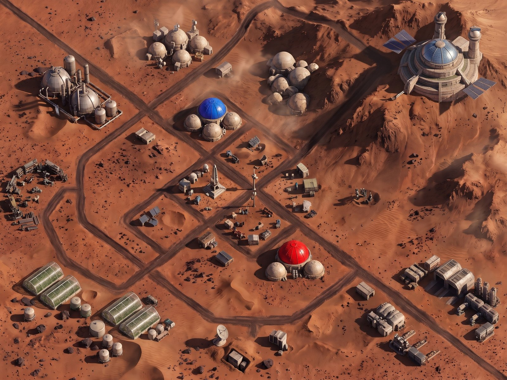
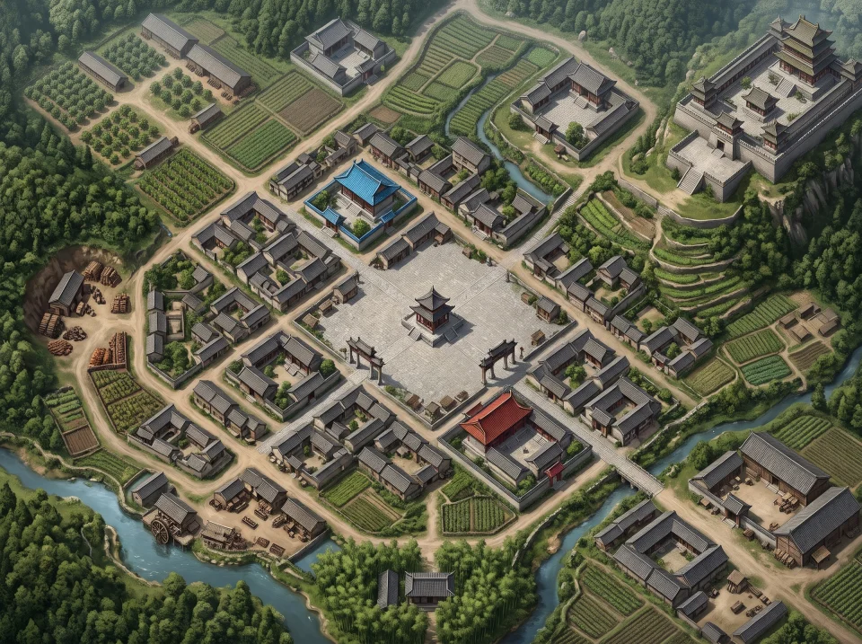
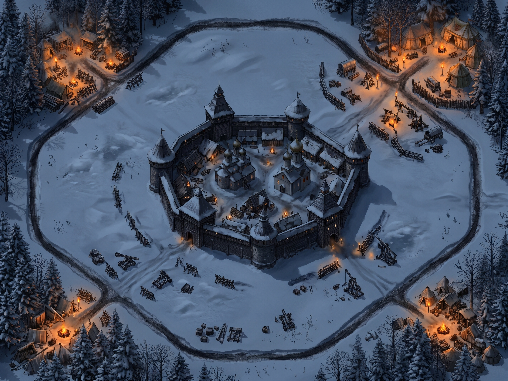

# Reskin kit

Repaint a stage (the city, or the siege) in another setting with an image generator, while keeping every messenger route,
so the existing animation plays over the new picture unchanged. Only two things are fixed: **the routes** (pixel paths in
`app/js/data/city.js` and `siege.js`) and **where each landmark stands**. Everything else (geography, weather, era, architecture, and what
each landmark actually is) is left to the generator, as long as each landmark plays its role in the allegory.

It works in two passes, because one pass cannot hold both the routes and a free hand:

| The town as a research colony on Mars | The town as an ancient Chinese city | The siege as the Siege of Pskov, 1581 |
|---|---|---|
|  |  |  |

These are the three shown on the app's landing page. The Mars one is one run of `generate`, untouched.
`examples/*-overlay.jpg` shows the routes drawn over the Mars and Pskov pictures.

1. **Ground.** `plate.png` (the routes as dark bands, nothing else) is repainted as the bare landscape of the setting. With
   no buildings to place, the generator keeps the bands almost pixel for pixel.
2. **Build.** A numbered disc is drawn on every place of that painting, and the generator replaces each disc with a
   landmark and fills the gaps. It is now editing a finished picture, so the routes stay where pass 1 put them.

## Use

```sh
export GEMINI_API_KEY=...
python3 world/reskin/reskin.py generate "a research colony on Mars" mars            # the city
python3 world/reskin/reskin.py generate --siege "thirteenth-century China, during the Mongol siege of the Song city of Xiangyang" xiangyang
                                                                                    # the siege: files are prefixed siege-
```

This writes, in `world/reskin/out/` (not committed):

| File | What it is |
|---|---|
| `mars-ground.png`, `mars-ground-overlay.png` | pass 1 and its check |
| `mars-ground-marked.png` | pass 1 with the discs: the input of pass 2 |
| `mars.png`, `mars-overlay.png` | **the result** and its check |

In an overlay, every magenta route should run on a visible route of the painting, and every yellow door should touch its
landmark. The ground is the cheap pass to get right: if `-ground-overlay.png` shows a missing or shifted route, delete
`mars-ground.png` and run again. If only pass 2 disappoints, run again as is; an existing ground is kept and built on.

**The camera is part of the prompt.** Both passes state the stage's own view (a parallel projection from the south-east,
about 50 degrees above the horizon, north to the upper right), because the animation's paths are drawn for that view.
Without it the siege came out as a straight-down plan.

**The siege is locked.** Pass 2 rounds the corners of the siege's ring road, so for the siege `generate` pastes the
routes of the ground painting back over the result, with soft edges (`lock`), and keeps the untouched pass 2 as
`-raw.png`. The city is not locked: its pass 2 keeps the roads, and a building standing in front of a road would be cut.

The model is always `gemini-nano-banana-2.1` (`MODEL` in the script). Do not use `gemini-3-pro-image` here: it repaints
the whole picture in pass 2, moves the routes and leaves discs in it.

### By hand, in any generator

```sh
python3 world/reskin/reskin.py prompts "a research colony on Mars"   # prints both prompts (add --siege for the siege)
```

1. Give the generator `plate.png` (or `siege-plate.png`) with the pass 1 prompt. Save the result and `check` it.
2. `python3 world/reskin/reskin.py mark ground.png`, then give `ground-marked.png` with the pass 2 prompt. `check` again.

### Fixing what drifted

- **Roads:** inpaint with `inpaint-mask-*.png` (use the one matching the image's width) and "A wide route, clearly
  different from the ground around it, matching the painting's style, light and perspective."
- **A landmark in the wrong place:** draw a small mask round its disc position and inpaint its line from the pass 2
  prompt, plus "matching the surrounding painting's style, light and perspective".

Then bake the picture like the other stage backgrounds (see `world/city_mockup.py --app --bg3d`) and give the places
names for the new setting.

## Files

| File | Use |
|---|---|
| `plate.png`, `siege-plate.png` | the input of pass 1: the routes as dark bands on blank ground |
| `guide.png`, `siege-guide.png` | the plate with the numbered discs, for reference: which number is where |
| `inpaint-mask-*.png`, `siege-inpaint-mask-*.png` | every route widened to ~44 px, for an inpainting pass (1600 and 1024 px wide) |
| `examples/` | results with their overlays: Mars and Pskov, shown above, and two earlier ones (Arctic sea ice, the Mongol siege of Xiangyang). The Chinese city above is the landing page's own copy in `app/img/` |
| `reskin.py` | `build` remakes the images above from the current routes (run it after any change to them); `generate`, `prompts`, `mark` and `check` as above. The two prompts live in it, as `GROUND` and `BUILD`, with each stage's landmarks in `STAGES`. |

## Landmarks

The prompt says what kind of place goes at each number, never which building, so the generator picks what suits the
setting.

| # | Stage name | Role in the allegory |
|---|---|---|
| 1 | winery | producer A: an independent working estate |
| 2 | northwest library | record-keeper |
| 3 | temple library | record-keeper beside authority |
| 4 | temple | seat of authority: the grandest place, on high ground |
| 5 | proposer P | rival household, twin of 8 (blue) |
| 6 | crossroads | open square where outsiders arrive |
| 7 | pottery | workshop |
| 8 | proposer Q | rival household, twin of 5 (red) |
| 9 | fishery | producer B: an independent working estate |
| 10 | southeast library | record-keeper |
| 11 | granary | producer C: an independent working estate |

The siege has five, and is always painted by night. Give it a siege from history as its setting:

| # | Stage name | Role in the allegory |
|---|---|---|
| 1, 4, 5 | camp C, camp B, camp A | camps of the besieging force, outside the ring road |
| 2 | commander's camp | its headquarters |
| 3 | enemy city | the besieged stronghold inside the ring, with no way in |

## What we learnt (Nov 2026)

Seven runs by hand, then about forty images through the API on deliberately extreme settings (Arctic sea ice, a stilt
village over a lagoon, Mars):

- **Starting from the original render** (Edo, Mexica): roads hold, but the old Greek layout leaks through (fields, wall,
  blocks).
- **Detailed prompts naming each building by its position** (Himalayan, Sahel): the landmarks looked great, but the
  rival houses landed left and right of the square in four runs out of four, and the town streets drifted.
- **One pass from the guide with numbered markers** (Egyptian, Chinese towns): good when the setting is a town on dry
  land. On extreme settings the outer loops and the inner grid drift, the square slides off its marker, and the red
  markers are painted into the picture.
- **The same pass with plate and numbered key as two images:** worse. The generator redraws the numbers wherever it
  put the buildings.
- **Ground first:** with nothing to place, the bands survive almost exactly, on every setting tried. The usual loss is
  the short stretch that runs along the top edge of the frame, and a dead end painted on to the edge.
- **Discs drawn onto the ground painting, then "replace each disc":** the landmarks land on their discs and the routes
  stay put, since the generator is editing one finished picture. Larger "building plot" shapes instead of discs gave
  bigger landmarks that sat across the routes.
- **The model matters more than the wording in pass 2.** `gemini-3-pro-image` repainted the whole picture and left
  discs in it; `gemini-nano-banana-2.1` edited in place and left none.
- **Say that routes are walked.** "A route people move along" produced canals in a river town; "walk along" gave
  tracks and bridges. Naming the stretch along the top edge did not save it: it is still the first thing to check.
- **A painterly setting drifts more.** The Song river town came out as an ink-and-wash illustration, and its inner
  grid wandered; the photographic settings (Mars, ice) held theirs.
- **Siege: discs off the roads.** With the camp discs on the ends of their spurs, pass 2 zoomed out and shrank the ring.
  They now sit on the camps' own positions, outside the ring, and the prompt says the ring keeps its size and its
  straight sides and that the camps are compact.
- **Siege: say where the camera is.** The octagon alone does not tell the generator the view, and it painted a plan
  seen from straight above. With the camera spelt out it paints the stage's own oblique view; the city did so anyway.
- **Siege: lock the routes.** With the camera right, pass 2 still rounded the ring's corners in four runs out of four
  (Xiangyang and Alesia, twice each), while pass 1 kept them sharp every time. Pasting the pass-1 routes back fixes it
  by construction.
- **Siege: no horizon.** A pass 1 that painted a horizon and sky gave a pass 2 that reframed the picture. The prompt now
  says the ground fills the frame. The ring still tends to round its corners (ice) or pull in a little on one side
  (Song); of three settings only Mars kept it exactly, and that one was a plan view. Hence the lock.
- **Keep the routes visible:** ask for strong contrast with the ground, and leave out people and animals, since they
  hide the messengers.
